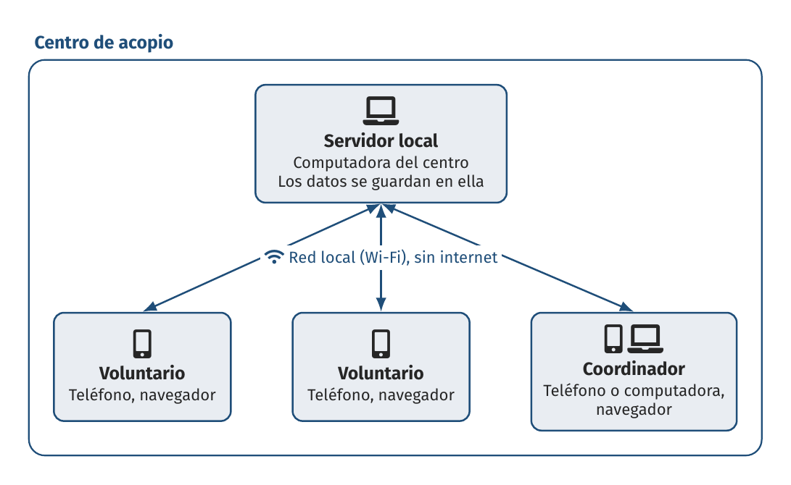

# ADR-0001: Modelo de despliegue

- **Estado:** Propuesto
- **Fecha de creación:** 2026-11-24
- **Fecha de decisión:** pendiente
- **Fecha límite para decidir:** al terminar las entrevistas con centros de acopio de la fase de investigación
- **Autor:** Aureliano Aristizabal ([arstbltech](https://github.com/arstbltech))
- **Participantes:** pendiente
- **Relacionado con:** [Planteamiento](../planteamiento.md), secciones 5.3 (Etapas de desarrollo), 7 (Condiciones de operación) y 9 (Pregunta abierta 3); [ADR-0002: Continuidad del servidor local](0002-continuidad-del-servidor-local.md); [ADR-0004: Red local del centro](0004-red-local-del-centro.md)

## Contexto y problema

La primera etapa del proyecto es que **un centro de acopio pueda administrar su propio inventario** (planteamiento, sección 5.3). Este ADR decide cómo se instala y dónde funciona ese sistema.

Los centros de acopio trabajan, durante una emergencia, en condiciones difíciles: sin conexión a internet o con conexión intermitente, con cortes eléctricos, con equipos modestos y con voluntarios sin formación técnica que rotan con frecuencia (planteamiento, sección 7).

Además, el sistema no debe depender de la ITVN ni de servicios externos para funcionar. Un centro de acopio debe poder instalarlo y usarlo por su cuenta, sin tener que pedir acceso ni esperar a que alguien lo configure.

En un mismo centro suelen trabajar varias personas a la vez, cada una con su teléfono o computadora, por lo que todas deben ver y modificar el mismo inventario.

**Pregunta que responde este ADR:** ¿dónde se ejecuta el sistema de inventario de un centro de acopio, y cómo trabajan con él varias personas a la vez?

Con esto se responde también a la pregunta abierta 3 del planteamiento: si cada centro debe tener su propio sistema o si todos deben trabajar en una misma instancia compartida.

### Fuera del alcance de este ADR

El **sistema central**, que unificará la información de todos los centros, corresponde a la segunda etapa del proyecto y se decidirá en su propio ADR cuando llegue el momento. Este ADR solo procura que el diseño no impida conectar más adelante cada centro con el sistema central.

## Criterios de decisión

1. **Funciona sin internet.** El centro puede registrar, consultar y despachar insumos sin conexión, durante horas o días.
2. **Varias personas a la vez.** Varios dispositivos de un mismo centro trabajan sobre el mismo inventario al mismo tiempo, sin necesidad de internet.
3. **Instalación sin conocimientos técnicos.** Se instala con doble clic, sin servidores, sin Docker y sin depender de la ITVN ni de servicios de terceros.
4. **Equipos modestos.** Funciona en computadoras y teléfonos de gama baja, con poco consumo de batería.
5. **Protección ante pérdida de datos.** Que se dañe o se pierda un equipo no significa perder el inventario.
6. **Mantenible por un equipo pequeño.** El desarrollo, las actualizaciones y el soporte están al alcance de un equipo reducido.

## Opciones consideradas

### Opción A: Un servidor en internet para todos los centros

Todos los centros usan una misma instancia alojada en internet y acceden desde el navegador. Es el modelo de Boxtribute y de OpenBoxes.

- **Ventajas:**
  - Es el modelo más sencillo de desarrollar y de mantener: un solo servidor y una sola base de datos.
  - Los centros solo necesitan un navegador y no instalan nada.
  - Las actualizaciones llegan a todos al mismo tiempo.
- **Inconvenientes:**
  - **Sin internet no funciona**, que es justo la condición más frecuente en una emergencia (incumple el criterio 1).
  - Si el servidor falla, todos los centros se detienen a la vez.
  - Los centros dependen por completo de quien aloja el servidor (incumple el criterio 3).

### Opción B: Servidor propio en cada centro

Cada centro instala su propio servidor, por ejemplo con Docker, y los dispositivos del centro se conectan a él.

- **Ventajas:**
  - Funciona sin internet y permite varios dispositivos a la vez.
  - Se puede partir de sistemas existentes pensados para servidor.
- **Inconvenientes:**
  - **La instalación requiere conocimientos técnicos** (Docker, configuración de red, bases de datos), que la mayoría de los centros no tiene (incumple el criterio 3).
  - Cada centro tiene que mantener su servidor: actualizaciones, copias de seguridad y resolución de fallos.

### Opción C: Aplicación web sin conexión en cada dispositivo (PWA)

Cada dispositivo usa una aplicación web instalable que guarda los datos en el propio navegador.

- **Ventajas:**
  - No hay que instalar nada más que la aplicación desde el navegador, y funciona igual en teléfonos y computadoras.
  - Funciona sin internet en cada dispositivo.
- **Inconvenientes:**
  - **Cada dispositivo tiene su propia copia de los datos.** Sin internet, los dispositivos de un mismo centro no ven lo que registran los demás (incumple el criterio 2).
  - Para unir lo que registró cada dispositivo hace falta un servidor e internet, y varios dispositivos pueden haber modificado lo mismo, lo que genera conflictos difíciles de resolver.
  - El navegador puede borrar los datos si se limpia la caché o si falta espacio (riesgo para el criterio 5).

### Opción D: Aplicación de escritorio con servidor local integrado

El centro instala la aplicación con doble clic en una computadora. Esa computadora funciona como **servidor local**: guarda los datos y los sirve por la red local (Wi-Fi), sin internet. El resto de dispositivos del centro se conectan a ella desde el navegador, por ejemplo escaneando un código QR que muestra la pantalla, sin instalar nada.

Es una sola aplicación con dos papeles:

| Papel | Qué hace | Dónde funciona | Instalación |
|---|---|---|---|
| **Servidor** | Guarda los datos del centro y ofrece la interfaz a los demás dispositivos por la red local. | Una computadora (Windows, Linux o macOS). En Android, pendiente de confirmar con un prototipo. | Con doble clic, solo en ese equipo. |
| **Cliente** | Es la interfaz con la que se registra y se consulta el inventario. | El navegador de cualquier teléfono, tablet o computadora. | Ninguna. |

Un dispositivo que solo usa el navegador es siempre cliente: no guarda el inventario ni puede convertirse en servidor. Un dispositivo con la aplicación instalada puede funcionar como servidor o, como se explica en el [ADR-0002](0002-continuidad-del-servidor-local.md), como réplica del servidor, y también sirve para trabajar como cualquier cliente.

Los roles de las personas (voluntario, coordinador) no dependen del dispositivo. Un coordinador puede trabajar desde el navegador de su teléfono, pero para que ese teléfono pueda tomar el relevo del servidor necesita tener la aplicación instalada.

- **Ventajas:**
  - Funciona sin internet, con varios dispositivos a la vez y con una instalación de doble clic (cumple los criterios 1, 2 y 3).
  - **No hay conflictos entre dispositivos**, porque todos escriben en la misma computadora.
  - Los voluntarios no instalan nada en sus teléfonos, lo que encaja con la alta rotación.
  - Existe un sistema en uso que sigue este modelo: Open mSupply, en más de 30 países para cadenas de suministro de salud. También Kolibri, en educación.
- **Inconvenientes:**
  - Hace falta una computadora encendida mientras se trabaja. Si se apaga o se queda sin batería, los demás dispositivos no pueden registrar.
  - Es más complejo de desarrollar que la opción A: hay que construir el servidor local y el empaquetado para cada sistema operativo.
  - Algunas funciones del navegador, como el uso de la cámara o el funcionamiento sin conexión, exigen HTTPS, que es difícil de tener en una red local sin internet.
  - Las actualizaciones no llegan solas a las instalaciones que pasan mucho tiempo sin conexión.

### Comparación

| Criterio | A. Servidor en internet | B. Servidor por centro | C. PWA por dispositivo | D. Escritorio con servidor local |
|---|---|---|---|---|
| 1. Sin internet | ❌ | ✅ | ✅ | ✅ |
| 2. Varias personas a la vez | ✅ (con internet) | ✅ | ❌ | ✅ |
| 3. Instalación sin conocimientos técnicos | ✅ (no se instala) | ❌ | ✅ | ✅ |
| 4. Equipos modestos | ✅ | ⚠️ | ✅ | ✅ |
| 5. Protección ante pérdida | ✅ | ⚠️ | ❌ | ⚠️ Con copias de seguridad |
| 6. Mantenible por un equipo pequeño | ✅ | ❌ | ⚠️ | ⚠️ |

## Decisión

Se recomienda la **Opción D: aplicación de escritorio con servidor local integrado**.

Es la única opción que cumple a la vez los tres criterios más importantes: funcionar sin internet, permitir que varias personas trabajen al mismo tiempo e instalarse sin conocimientos técnicos.

A la pregunta 3 del planteamiento, este ADR responde que **cada centro tiene su propio sistema**. Una misma instancia compartida (opción A) no funcionaría sin internet.

Este ADR decide el **modelo de despliegue**, no la tecnología concreta. La tecnología (por ejemplo Tauri, Electron u otra) y la posible reutilización de sistemas existentes se decidirán en ADR posteriores.

La decisión queda en estado **Propuesto** hasta validar en las entrevistas con centros de acopio las preguntas abiertas de abajo.

## Consecuencias

- **Positivas:**
  - Cada centro administra su inventario con independencia de la ITVN y de servicios de terceros.
  - El mismo sistema sirve para un centro pequeño con una sola computadora y para uno grande con muchos dispositivos.
  - Como cada centro tiene sus propios datos, conectarlo en la segunda etapa con el sistema central consistirá en enviar esos datos, sin cambiar la forma en que el centro trabaja.
- **Negativas:**
  - **Boxtribute no puede usarse tal cual como base.** Es un sistema de servidor que depende de MySQL, de Auth0 (un servicio externo) y de su versión antigua en PHP. Sigue siendo una referencia valiosa por su modelo de datos (cajas, productos, ubicaciones y envíos) y por su experiencia en el terreno.
  - El esfuerzo de desarrollo es mayor que con un único servidor en internet.
  - Hay que dar soporte a varios sistemas operativos (Windows, y posiblemente Linux, macOS y Android).
  - Cada centro es responsable de la computadora donde está su inventario.
- **Riesgos y cómo mitigarlos:**
  - **Pérdida o daño de la computadora:** ofrecer copias de seguridad en un pendrive. Cómo sigue trabajando el centro cuando falla su servidor local, y cómo se recupera, se trata en el [ADR-0002](0002-continuidad-del-servidor-local.md).
  - **Cortes eléctricos:** preferir portátiles con batería y que la aplicación consuma poco. Si la computadora se apaga, otro dispositivo puede tomar su lugar como servidor ([ADR-0002](0002-continuidad-del-servidor-local.md)).
  - **Funciones del navegador que exigen HTTPS:** no depender de ellas en la primera etapa. La protección de la conexión se trata en el [ADR-0004](0004-red-local-del-centro.md).
  - **Acceso no autorizado desde la red local:** exigir una cuenta personal con PIN o contraseña para cada persona, gestionada desde el propio centro ([ADR-0003](0003-usuarios-y-acceso.md)).

## Preguntas abiertas

Se resolverán en las entrevistas con centros de acopio y con prototipos:

- ¿Los centros tienen **computadora**, o trabajan solo con **teléfonos**? ¿Con qué sistema operativo y de qué antigüedad?
- ¿Tienen **router o Wi-Fi** en el centro, aunque no haya internet?
- ¿**Cuántas personas registran a la vez** en un mismo centro?
- ¿Cuántas horas suelen pasar **sin electricidad**?
- Si un centro solo tiene teléfonos, ¿puede un teléfono o una tablet Android hacer de servidor local, como en Open mSupply? Un teléfono podría además crear su propio punto de acceso Wi-Fi, pero hay que comprobar con un prototipo la batería, cuántos dispositivos admite y si Android mantiene la aplicación activa.

## Referencias

- [Planteamiento del problema y propuesta](../planteamiento.md)
- [Open mSupply: diseño técnico](https://msupply.foundation/open-msupply/design). Sistema que sigue el modelo de la opción D. Su licencia limita el uso a servicios de salud, por lo que se toma como referencia de arquitectura y no como base.
- [Kolibri](https://learningequality.org/kolibri/). Plataforma educativa que funciona sin conexión y sirve contenido por red local.
- [Boxtribute](https://github.com/boxwise/boxtribute). Sistema humanitario de inventario basado en un servidor en internet (opción A).
- [Relief Inventory](https://github.com/fiforms/reliefinventory). Inventario de donaciones para desastres, con una imagen para Raspberry Pi que funciona sin internet.
- [LSS/SUMA, Organización Panamericana de la Salud](https://www.paho.org/es/temas/respuesta-emergencias-salud-desastres/sistema-lss). Sistema de gestión de suministros humanitarios usado en América Latina. Pendiente de evaluar.
- [Local-first software](https://www.inkandswitch.com/local-first/), Ink & Switch (2019). Artículo de referencia sobre aplicaciones que guardan los datos primero en el propio equipo.
