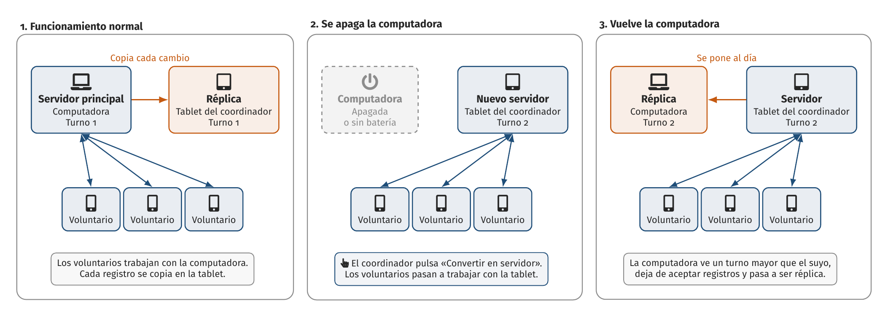

# ADR-0002: Continuidad del servidor local

- **Estado:** Propuesto
- **Fecha de creación:** 2026-11-24
- **Fecha de decisión:** pendiente
- **Fecha límite para decidir:** al terminar las entrevistas con centros de acopio de la fase de investigación
- **Autor:** Aureliano Aristizabal ([arstbltech](https://github.com/arstbltech))
- **Participantes:** pendiente
- **Relacionado con:** [ADR-0001: Modelo de despliegue](0001-modelo-de-despliegue.md); [ADR-0004: Red local del centro](0004-red-local-del-centro.md)

## Contexto y problema

El [ADR-0001](0001-modelo-de-despliegue.md) propone que cada centro de acopio tenga una computadora que funciona como servidor local: guarda el inventario y los voluntarios se conectan a ella por la red local.

Esa computadora es un **punto único de fallo**. Si se queda sin batería, se daña, se la llevan o hay un corte eléctrico, nadie en el centro puede seguir registrando. Como el sistema central llegará en una etapa posterior del proyecto, los datos del centro solo existen en esa computadora y en las copias que el propio centro haga.

Hace falta que otro dispositivo del centro, por ejemplo la tablet o el teléfono del coordinador, tenga una copia al día del inventario y pueda tomar el lugar de la computadora cuando esta falle.

Pero no todos los centros tendrán ese segundo dispositivo. También hay que prever qué pasa si la computadora se daña y no hay réplica, y qué pasa si falta la única persona con acceso de coordinador.

**Pregunta que responde este ADR:** ¿cómo sigue trabajando un centro de acopio si su servidor local deja de funcionar, sin depender de internet, y cómo se recupera si no había otro dispositivo preparado?

## Criterios de decisión

1. **Nunca hay dos servidores aceptando registros a la vez.** El inventario del centro es uno solo y no puede quedar dividido.
2. **No se pierden registros confirmados.** Si el sistema le dijo a un voluntario que su registro se guardó, ese registro no puede desaparecer.
3. **El centro recupera la operación en pocos minutos**, sin conocimientos técnicos.
4. **Funciona sin internet**, solo con la red local.
5. **Simplicidad.** Debe poder implementarse, probarse y mantenerse con un equipo pequeño.
6. **Seguridad.** Solo los dispositivos autorizados guardan una copia completa del inventario.

## Opciones consideradas

### Opción A: Solo copias de seguridad

El servidor local permite exportar una copia de seguridad, por ejemplo a un pendrive. Si la computadora falla, se instala el sistema en otra y se restaura la última copia.

- **Ventajas:**
  - Es la opción más sencilla de implementar.
  - No hay ningún riesgo de tener dos servidores a la vez.
- **Inconvenientes:**
  - Se pierde todo lo registrado desde la última copia (incumple el criterio 2).
  - Recuperarse exige otra computadora, instalar el sistema y restaurar la copia, lo que puede llevar mucho tiempo (incumple el criterio 3).
  - Depende de que alguien recuerde hacer las copias.

### Opción B: Réplica con cambio manual

Un dispositivo autorizado **con la aplicación instalada**, como la tablet del coordinador o una segunda computadora, funciona como **réplica**: recibe por la red local cada cambio que se registra en la computadora y mantiene una copia al día. Si la computadora falla, el coordinador pulsa **«Convertir en servidor»** y la tablet pasa a ser el servidor del centro. Cuando la computadora vuelve, detecta que ya hay otro servidor y pasa a ser réplica.

Un dispositivo que solo usa el navegador no puede ser réplica, porque el navegador no guarda el inventario completo de forma segura ni puede ofrecerlo a los demás dispositivos.

- **Ventajas:**
  - El centro se recupera en minutos y sin conocimientos técnicos (cumple el criterio 3).
  - Funciona solo con la red local (cumple el criterio 4).
  - Una persona decide el cambio, y una persona sí puede comprobar si la computadora está apagada o si solo falló el Wi-Fi. Así se evita el cerebro dividido de la opción C (cumple el criterio 1).
- **Inconvenientes:**
  - Requiere que alguien esté presente y pulse el botón.
  - Si la computadora falla justo después de registrar algo y antes de copiarlo, ese registro no está en la réplica (ver la sección *Funcionamiento propuesto*).
  - Una tablet o un teléfono como servidor consume más batería y debe mantener la aplicación activa.

### Opción C: Réplica con cambio automático entre dos dispositivos

Igual que la opción B, pero la réplica toma el control sola cuando deja de recibir respuesta de la computadora durante un tiempo.

- **Ventajas:**
  - No necesita que nadie intervenga.
- **Inconvenientes:**
  - **Con dos dispositivos, la réplica no puede distinguir si la computadora se apagó o si solo se perdió la conexión entre ellos.** Si se cae el Wi-Fi o la tablet queda fuera de alcance, la tablet se convierte en servidor mientras la computadora sigue funcionando. Hay dos servidores aceptando registros a la vez y el inventario queda dividido. Es lo que se conoce como *cerebro dividido* (*split-brain*) (incumple el criterio 1).

### Opción D: Grupo de tres o más dispositivos con elección automática

Tres o más dispositivos del centro votan cuál es el servidor, con un algoritmo de consenso como Raft. Un dispositivo solo es servidor si lo apoya la mayoría, de modo que nunca puede haber dos.

- **Ventajas:**
  - El cambio es automático y seguro.
- **Inconvenientes:**
  - Necesita al menos tres dispositivos encendidos y conectados. Si falla la mayoría, el centro se detiene.
  - Es mucho más complejo de implementar, probar y mantener (incumple el criterio 5).
  - Es desproporcionado para la mayoría de los centros, que tendrán uno o dos dispositivos de confianza.

### Comparación

| Criterio | A. Copias de seguridad | B. Réplica manual | C. Réplica automática (2) | D. Elección automática (3+) |
|---|---|---|---|---|
| 1. Nunca dos servidores | ✅ | ✅ (con turnos) | ❌ | ✅ |
| 2. No se pierden registros confirmados | ❌ | ✅ (con confirmación) | ⚠️ | ✅ |
| 3. Recuperación en minutos | ❌ | ✅ | ✅ | ✅ |
| 4. Sin internet | ✅ | ✅ | ✅ | ✅ |
| 5. Simplicidad | ✅ | ⚠️ | ⚠️ | ❌ |
| 6. Seguridad | ⚠️ (pendrive) | ✅ | ✅ | ⚠️ (más copias) |

## Decisión

Se recomienda la **Opción B: réplica con cambio manual**, junto con la **Opción A** como protección básica para cualquier centro, tenga réplica o no (ver *Recuperación cuando no hay réplica*).

Es la única opción que permite recuperarse en minutos sin arriesgar que el inventario quede dividido, y su complejidad es razonable. La opción D queda como posible mejora para centros grandes si la experiencia lo justifica.

### Funcionamiento propuesto

- **Roles.** En cada centro hay un **servidor**, que acepta los registros; como máximo una **réplica**, que mantiene una copia al día y necesita tener la aplicación instalada; y los **clientes**, que entran desde el navegador. El coordinador puede trabajar desde la propia réplica.
- **Registro de cambios.** Cada cambio en el inventario se guarda como una entrada de un registro ordenado y numerado. La réplica recibe esas entradas en orden. Más adelante, el mismo registro servirá también para enviar los datos al sistema central.
- **Turnos.** Cada vez que un dispositivo se convierte en servidor, el **turno** aumenta en uno. Cada entrada del registro guarda el turno en que se creó.
  - Los clientes y la réplica solo aceptan órdenes del servidor con el turno más alto que conocen.
  - Un servidor que descubre un turno mayor que el suyo deja de aceptar registros y pasa a ser réplica.
- **Confirmación de registros.** Mientras la réplica está conectada, el servidor solo confirma un registro al voluntario cuando la réplica ya lo tiene. Si la réplica se desconecta o no responde en un tiempo máximo (por ejemplo, 2 segundos), el servidor confirma igual, sigue funcionando solo y muestra un aviso de **«Sin réplica»**. Así una réplica con poca señal nunca frena a los voluntarios ([ADR-0004](0004-red-local-del-centro.md)).
- **Cambio de servidor.** Solo un usuario con rol de coordinador puede convertir la réplica en servidor. Antes de hacerlo, el sistema le pide que confirme que la computadora está apagada o inaccesible.
- **Regreso del servidor anterior.** Cuando la computadora vuelve, ve que hay un turno mayor y pasa a ser réplica. Si tenía registros que no llegó a copiar, no se descartan: se muestran al coordinador como **«registros pendientes de revisar»** para que decida si se incorporan.
- **Descubrimiento.** El servidor se anuncia en la red local para que los clientes lo encuentren solos. Además muestra un código QR con su dirección.

### Recuperación cuando no hay réplica

Si la computadora se daña y no había réplica, el centro se recupera desde el último lugar donde quedaron sus datos. El principio es que **perder un equipo nunca debe significar perderlo todo**.

| Si… | Cómo se recupera | Qué se pierde |
|---|---|---|
| **El disco de la computadora sigue bien** (se dañó la pantalla, la placa o la batería) | Se copia el archivo de datos del disco y se abre en otra computadora con el sistema instalado. | Nada. |
| **Hay una copia de seguridad** en el pendrive del centro | En otra computadora, se instala el sistema y se elige **«Restaurar copia»**. | Lo registrado desde la última copia. |
| **No hay ninguna copia** | Se cuentan las cajas y se registran con el modo de **conteo inicial**. | El historial de movimientos, pero no los insumos. |

Para reducir lo que se pierde:

- **Todos los datos en un solo archivo.** El servidor guarda el inventario en un único archivo, en una ubicación conocida y documentada. Si el disco sobrevive, cualquier persona con conocimientos básicos puede recuperarlo.
- **Copias automáticas al pendrive.** Cada vez que se conecta el pendrive registrado del centro, el servidor guarda en él una copia cifrada, sin que nadie tenga que acordarse. Basta con dejarlo conectado.
- **Conteo inicial.** El sistema tiene un modo para registrar rápidamente todo lo que hay en el centro. Sirve para empezar de cero tras una pérdida y también para cualquier centro nuevo.

**Al restaurar, el turno aumenta**, igual que cuando una réplica se convierte en servidor. Así, si la computadora original vuelve a funcionar con datos antiguos (por ejemplo, porque solo se había quedado sin batería), descubre que hay un turno mayor y no puede seguir aceptando registros.

### Recuperación del acceso de coordinador

Otro caso es que el equipo funcione pero falte la persona: si el único coordinador no está disponible, nadie puede restaurar copias, crear usuarios ni preparar una réplica.

- **Hoja de recuperación.** Al instalar el sistema se genera un código de recuperación, como los códigos de respaldo de la verificación en dos pasos. Se imprime o se fotografía, y lo guarda el responsable de la organización (por ejemplo, el párroco, el director o la junta directiva). Con ese código, otra persona puede tomar el rol de coordinador.
- **Dos coordinadores por centro.** El sistema recomienda, sin obligar, que cada centro tenga al menos dos personas con rol de coordinador.

Cómo entran las personas al sistema y cómo se recupera el acceso de voluntarios y coordinadores se trata en el [ADR-0003](0003-usuarios-y-acceso.md).

### Garantías del protocolo

El protocolo debe cumplir estas propiedades en cualquier combinación de fallos (apagados, cortes de red, restauraciones de copias en otra computadora y regresos en cualquier momento), y se comprobarán con pruebas que simulen esos fallos:

1. En un mismo turno, como máximo un dispositivo acepta registros.
2. Ningún registro confirmado se pierde.
3. Cuando el servidor anterior vuelve y se reconecta, termina como réplica y con los mismos datos que el servidor.

### Orden de implementación

- **Primero:** un solo servidor por centro, con los datos en un solo archivo, copias automáticas al pendrive, modo de conteo inicial y hoja de recuperación. El registro de cambios ya se diseña **con números de entrada y turnos**, para que la réplica pueda añadirse sin rehacer la base.
- **Después:** la réplica con cambio manual.
- **Más adelante, si la experiencia lo justifica:** que el servidor reparta copias cifradas entre los teléfonos de los voluntarios. Los voluntarios no podrían leerlas, pero el coordinador podría restaurarlas en otra computadora con su clave. Así los datos quedarían repartidos en el centro aunque no haya réplica.

### Cuando exista el sistema central

El sistema central corresponde a la segunda etapa del proyecto y no forma parte de esta decisión. Cuando exista, ampliará la recuperación con estas posibilidades, que se decidirán en su propio ADR:

- Recuperar el inventario de un centro desde el sistema central, en otra computadora.
- Reconstruir el historial de un centro a partir de los envíos que registraron los centros que los recibieron.
- Recuperar el acceso de coordinador a través de la ITVN, que tendrá la información de verificación del responsable de cada centro (planteamiento, sección 5.4).
- Rechazar en el sistema central los datos de un servidor cuyo turno sea menor que el último conocido de ese centro.

## Consecuencias

- **Positivas:**
  - Un centro puede seguir trabajando aunque falle su computadora, sin internet.
  - Aunque no haya réplica, ningún fallo deja al centro sin una forma de recuperarse: como mínimo, el conteo inicial.
  - El registro de cambios con turnos sirve a la vez para la réplica y para las restauraciones, y más adelante servirá para enviar los datos al sistema central.
  - Las garantías del protocolo quedan definidas desde el principio, lo que permite comprobarlas con pruebas.
- **Negativas:**
  - El servidor local es más complejo: tiene que gestionar roles, turnos y el envío de cambios a la réplica.
  - Para que la réplica sea una tablet o un teléfono, la aplicación tiene que funcionar en Android, lo que está pendiente de confirmar con un prototipo ([ADR-0001](0001-modelo-de-despliegue.md)). Mientras tanto, la réplica puede ser una segunda computadora.
  - Cada registro tarda un poco más en confirmarse mientras haya réplica.
- **Riesgos y cómo mitigarlos:**
  - **El coordinador convierte la réplica en servidor aunque la computadora sigue funcionando** (por ejemplo, porque solo falló el Wi-Fi): el turno nuevo hace que la computadora deje de aceptar registros en cuanto lo descubre, y lo que registró mientras tanto pasa a «pendientes de revisar». La pantalla de confirmación debe explicar este riesgo con claridad.
  - **El sistema operativo cierra la aplicación en la tablet** para ahorrar batería: mantenerla activa con una notificación fija, como hace Open mSupply en Android.
  - **Se pierde o roban la tablet con la copia completa:** cifrar los datos de la réplica, protegerla con PIN y permitir que el coordinador la revoque desde el servidor.
  - **Nadie configura la réplica:** que el servidor recuerde a menudo que no hay réplica ni copia de seguridad reciente.
  - **Se pierde o roban el pendrive:** las copias van cifradas y solo se pueden restaurar con la clave del centro.
  - **Se pierde la hoja de recuperación o alguien la usa sin permiso:** guardarla en un lugar seguro, permitir que el coordinador genere una nueva (y que la anterior deje de servir), y que cada uso quede registrado y se avise a los coordinadores.

## Preguntas abiertas

- ¿Los coordinadores tienen una tablet, un teléfono Android o una segunda computadora con espacio y batería suficientes para hacer de réplica?
- ¿Cuántas personas por centro deberían poder hacer el cambio de servidor?
- ¿Puede ser réplica el teléfono de cualquier voluntario, o solo dispositivos registrados por el coordinador?
- ¿Cuánto tiempo aguanta una tablet funcionando como servidor con la batería?
- ¿Cuánto retraso al confirmar un registro es aceptable para los voluntarios?
- ¿Quién guarda la hoja de recuperación en cada tipo de organización (parroquia, ONG, consejo comunal, universidad)?
- ¿Los centros tienen un pendrive que puedan dejar conectado a la computadora?
- ¿Estarían dispuestos los voluntarios a guardar copias cifradas del inventario en sus teléfonos?

## Referencias

- [ADR-0001: Modelo de despliegue](0001-modelo-de-despliegue.md)
- Martin Kleppmann, *Designing Data-Intensive Applications* (O'Reilly, 2017), capítulo 5, *Replication*. Explica la replicación con un líder, los cambios de líder y el cerebro dividido.
- [The Raft Consensus Algorithm](https://raft.github.io/). Algoritmo de consenso de la opción D. Su concepto de *term* inspira los turnos de este ADR.
- [Open mSupply: sincronización](https://msupply.foundation/open-msupply/sync). Sistema que funciona sin conexión y usa tablets Android como servidor.
